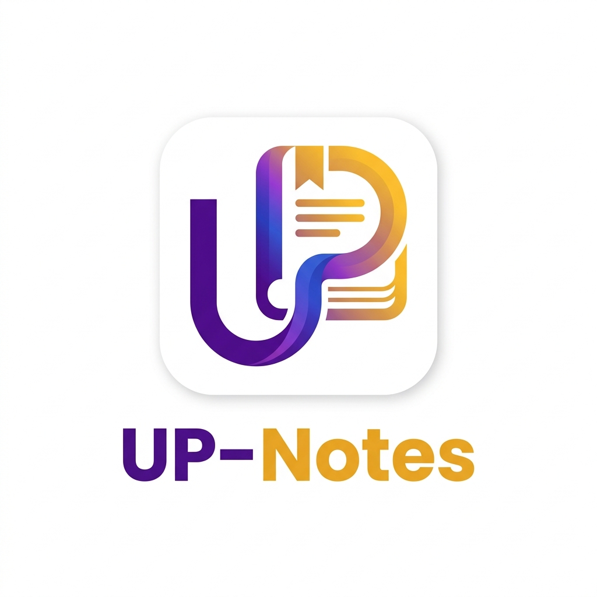

<p align="center">
  
</p>

<h1 align="center">📚 UP-Notes (TEAM:CS-Sheet-67)</h1>

<p align="center">
  <strong>คลังปันสรุปบทเรียนและโน้ตย่อสำหรับนิสิต มหาวิทยาลัยพะเยา</strong>
</p>

<p align="center">
  <a href="#-features"></a>
  
  
</p>

<p align="center">
  <strong>UP-Notes</strong> คือแพลตฟอร์มศูนย์กลางสำหรับการแบ่งปันโน้ตและสรุปบทเรียนสำหรับนิสิตมหาวิทยาลัยพะเยา (UP) ช่วยให้นิสิตสามารถอัปโหลด ค้นหา ดาวน์โหลด และกดถูกใจสรุปการเรียน (ไฟล์ PDF หรือรูปภาพ) โดยจัดหมวดหมู่ตามรหัสวิชา ปีการศึกษา และหมวดหมู่ต่าง ๆ อย่างเป็นระบบ
</p>

---

## 🧭 สารบัญ (Table of Contents)
1. [👥 สมาชิกทีมพัฒนา (Team Members)](#-สมาชิกทีมพัฒนา-team-members)
2. [🛠️ เทคโนโลยีที่ใช้ (Tech Stack)](#-เทคโนโลยีที่ใช้-tech-stack)
3. [🚀 การเริ่มต้นใช้งาน (Getting Started)](#-การเริ่มต้นใช้งาน-getting-started)
4. [🏛️ สถาปัตยกรรมและการออกแบบ (Architecture & Design)](#%EF%B8%8F-สถาปัตยกรรมและการออกแบบ-architecture--design)
5. [👥 ความต้องการของระบบ (Requirements)](#-ความต้องการของระบบ-requirements)
6. [🤝 ข้อตกลงในการทำงานร่วมกัน (Team Working Agreements)](#-ข้อตกลงในการทำงานร่วมกัน-team-working-agreements)

---

## 👥 สมาชิกทีมพัฒนา (Team Members)
### 🏛️ ทีม CS-Sheet-67
**Project Theme:** คลังปันสรุปบทเรียนและโน้ตย่อสำหรับนิสิต มหาวิทยาลัยพะเยา (Student Learning Resources & Knowledge Base Platform)

| รายชื่อสมาชิก | รหัสนิสิต | บทบาทการทำงาน (GitHub) | เอกสารการสะท้อนคิด (Team Intro) |
| :--- | :--- | :--- | :--- |
| **นาย อธิวัฒน์ บวรกิจ** | 67026179 | [@Atiwat-Bowornkit](https://github.com/Atiwat-Bowornkit) | [team/Atiwat.md](./team/Atiwat.md) |
| **นาย ถิรวัฒน์ วงค์ทอง** | 67020960 | [@Thararee](https://github.com/Thararee) | [team/Thirawat.md](./team/Thirawat.md) |
| **นาย นนทกร สิงห์ทอน** | 67027024 | [@nonthakorn2006](https://github.com/nonthakorn2006) | [team/Nonthakorn.md](./team/Nonthakorn.md) |
| **นางสาว ธนวรรณ สมแก้ว** | 67021017 | [@Tanawan28](https://github.com/Tanawan28) | [team/Tanawan.md](./team/Tanawan.md) |

---

## 🛠️ เทคโนโลยีที่ใช้ (Tech Stack)

เราพัฒนาโปรเจกต์นี้ด้วยเทคโนโลยีที่ทันสมัยและเป็นมาตรฐานอุตสาหกรรม:

| Category | Technology | Badges |
| :--- | :--- | :--- |
| **Frontend & Backend** | Next.js 14+ (App Router) & TypeScript |   |
| **Styling** | Tailwind CSS & shadcn/ui & Lucide React |  |
| **Database & ORM** | PostgreSQL & Prisma ORM |   |
| **Auth & Storage** | Supabase (Auth & Object Storage) |  |
| **Containerization**| Docker & Docker Compose |  |

---

## ภาพร่าง (Wireframe)

User Login:https://excalidraw.com/?fbclid=IwY2xjawS6iQVleHRuA2FlbQIxMQBzcnRjBmFwcF9pZAwzNTA2ODU1MzE3MjgAAR5EL9YQ3fTCGxdeNSQsH6eJdumUYHwnJbe8YB3ak_VsjL5xGvaU_EThAjk_Jw_aem_D3xBH3eZyJyHjmW9qspw_w#json=gMRNI5_PVeTxma-WvyrWg,Ulb6MG328SlBWJF2ulT-0g
User Dashboard:https://excalidraw.com/#json=T6C7Ppcm2HmcHCRq6Hl0_,RTbzfau-9iAXoNA52Mlalw
Notes Upload:https://excalidraw.com/#json=xd7RRHR56sFW2iNtNQXRo,hqFNWx163J_oMUZ2iGwlFg
Admin Dashboard:https://excalidraw.com/#json=XdPyCNGxwbz37hamCW4fO,wf-8IQA2v-Vs0iR_jclvOw


---

---

## 🚀 การเริ่มต้นใช้งาน (Getting Started)

ส่วนนี้อธิบายขั้นตอนการติดตั้งและรันโปรเจกต์เพื่อนำไปใช้งานบนเครื่องคอมพิวเตอร์ของคุณ

### 📋 Prerequisites (สิ่งที่ต้องเตรียมไว้ก่อน)
- **Git**
- **Node.js 20+** (พร้อม npm)
- **Docker & Docker Compose** (ถ้าต้องการรันแบบ container)
- บัญชี **Supabase** (สำหรับ Auth/Storage) — ขอ URL และ anon key จากหัวหน้าทีม

---

### 💻 การติดตั้งและรันแอปพลิเคชัน (ด้วย Docker)

#### 1. Clone the repository:
```bash
# โคลนคลังเก็บซอร์สโค้ด
git clone https://github.com/Software-Engineering-Concepts-2026/se-sec1-team-06.git
cd se-sec1-team-06

# สร้างสาขางาน (Branch) ใหม่เพื่อเริ่มพัฒนา
git checkout -b ประเภทงาน/เนื้อหางานที่ทำ
```

##### 🔄 สำหรับการบันทึกงานและส่งการเปลี่ยนแปลง (Git Flow)
```bash
# เตรียมบันทึกการแก้ไข
git add .

# บันทึกประวัติการเปลี่ยนแปลง
git commit -m "ข้อความอธิบายการเปลี่ยนแปลง"

# อัปโหลดสาขางานขึ้น GitHub
git push -u origin branch-name
```

##### 🔀 ขั้นตอนการอัปเดตกิ่งหลัก (Merge to Main)
1. ไปที่หน้า **Pull Request** บน GitHub
2. คลิกแท็บ **Files changed** เพื่อรีวิวโค้ด
3. คลิก **Review changes**
4. เลือก **Approve** แล้วกด **Submit**

#### 2. ตั้งค่าและรันเว็บ UP-Notes (Next.js)
```bash
# ติดตั้ง dependencies
npm install

# สร้างไฟล์ค่าตั้งต้นของเครื่องตัวเอง แล้วแก้ค่าใน .env.local (ห้าม commit ไฟล์นี้)
cp .env.example .env.local

# สร้าง Prisma client จาก prisma/schema.prisma
npm run db:generate

# รันเว็บโหมดพัฒนา แล้วเปิด http://localhost:3000
npm run dev
```

คำสั่งที่ใช้ตรวจงานก่อนเปิด PR (เหมือนที่ CI รัน):
```bash
npm run lint        # ESLint (src, tests)
npm run typecheck   # TypeScript strict
npm test            # unit + property tests
npm run build       # production build
```

#### 3. รันด้วย Docker Compose (เว็บ + PostgreSQL)
```bash
docker compose up --build
# เว็บ: http://localhost:3000   ตรวจสถานะ: http://localhost:3000/api/health
```

#### 4. โครงสร้างโฟลเดอร์ (Modular Monolith ตาม ADR 0001)
| โฟลเดอร์ | หน้าที่ |
| :--- | :--- |
| `app/` | หน้าเว็บและ API route (Next.js App Router) |
| `components/` | UI ที่ใช้ร่วมกัน เช่น Navbar |
| `modules/auth`, `modules/notes`, `modules/admin` | โค้ดตามโดเมน — แต่ละคนดูแลโมดูลของตัวเอง |
| `lib/` | Supabase client, Prisma client, ตัวช่วยอ่านค่า env |
| `prisma/schema.prisma` | โครงสร้างฐานข้อมูล (User, Note, Like, Report) |
| `src/`, `tests/` | helper logic เดิม (JS) และเทสต์ — เรียกใช้จาก `modules/` ได้ |
| `prototypes/`, `services/` | ต้นแบบ Sprint 1 และ stats-service เดิม (ไม่ได้ใช้ในเว็บจริง) |

---

## 🏛️ สถาปัตยกรรมและการออกแบบ (Architecture & Design)

รายละเอียดการตัดสินใจเชิงเทคนิคและแผนผังระบบมีบันทึกไว้อย่างชัดเจนในโฟลเดอร์ `/docs/architecture`:

- 🗺️ **[C4 Models & Tech Stack](./docs/architecture/README.md)** - แผนภาพโครงสร้างระบบแต่ละระดับ
- 📝 **[Architectural Decision Records (ADRs)](./docs/architecture/adr/)** - เอกสารบันทึกการตัดสินใจการเลือกใช้สถาปัตยกรรม

---

## 👥 ความต้องการของระบบ (Requirements)

ข้อมูลผู้ใช้จำลอง (User Personas) และสถานการณ์การใช้งานหลักที่เป็นตัวขับเคลื่อนการพัฒนา:

- 📊 **[Requirements Overview (SRS)](./docs/requirements/srs.md)** - ภาพรวมความต้องการระบบ (SRS)
- 👤 **[User Personas](./docs/requirements/personas/)** - ข้อมูลจำลองของกลุ่มเป้าหมายผู้ใช้งาน
- 🎬 **[Main User Scenario](./docs/requirements/main_scenario.md)** - ลำดับเหตุการณ์หลักที่ผู้ใช้งานโต้ตอบกับแอปพลิเคชัน

---

## 🤝 ข้อตกลงในการทำงานร่วมกัน (Team Working Agreements)

> เอกสารฉบับนี้คือข้อตกลงในการทำงานร่วมกันเพื่อช่วยให้สมาชิกทุกคนสื่อสารกันได้อย่างมีประสิทธิภาพ มีโค้ดที่มีคุณภาพ และลดปัญหาความขัดแย้งในทีม

### 📅 1. ความถี่ในการประชุม (Meeting Rhythms)
เราให้ความสำคัญกับการประชุมที่กระชับและไม่รบกวนตารางเรียนของเพื่อนร่วมงาน:

*   **Sprint Planning (วางแผนรอบการทำงาน):**
    *   **ความถี่:** ทุกสัปดาห์ (ช่วงสุดสัปดาห์ หรือวันเวลาที่ทุกคนตกลงร่วมกัน)
    *   **ระยะเวลา:** 30 - 60 นาที
    *   **เป้าหมาย:** เลือกงานจาก Backlog จัดลำดับความสำคัญ และแบ่งงานให้สมาชิกอย่างชัดเจน
*   **Daily Sync (การอัปเดตความคืบหน้า):**
    *   **ความถี่:** ทุกวัน (แบบออฟไลน์/Asynchronous)
    *   **รูปแบบ:** พิมพ์สรุปความคืบหน้าสั้น ๆ ในกลุ่มแชทของทีมโดยตอบคำถาม 3 ข้อ:
        1. *เมื่อวานนี้ทำอะไรไปแล้วบ้าง?*
        2. *วันนี้วางแผนจะทำอะไรต่อ?*
        3. *มีอุปสรรคหรือต้องการความช่วยเหลือในจุดใดหรือไม่?*
*   **Sprint Review & Retrospective (ตรวจรับงานและประเมินผล):**
    *   **ความถี่:** ทุกสิ้นรอบการทำงาน (สามารถทำต่อเนื่องกับการประชุม Planning รอบถัดไป)
    *   **ระยะเวลา:** 30 - 45 นาที
    *   **เป้าหมาย:** การสาธิตผลงาน (Demo) และสะท้อนมุมมองการทำงานร่วมกันว่ามีจุดใดที่ทำได้ดี และจุดใดที่ต้องแก้ไขในรอบถัดไป

---

### 💬 2. กฎการสื่อสาร (Communication Rules)
เพื่อความโปร่งใสและข้อมูลที่ตรงกันของทุกคนในทีม:

*   📢 **Public Over Private:** การหารือเรื่องโปรเจกต์ ปัญหาเทคนิค หรือการปรับเปลี่ยนใด ๆ ให้พูดคุยใน **"กลุ่มแชทสาธารณะของทีม"** เพื่อให้เกิดความเข้าใจตรงกันและย้อนกลับมาอ่านข้อมูลได้ (หลีกเลี่ยงการ Direct Message คุยกันส่วนตัว ยกเว้นเรื่องส่วนบุคคลจริง ๆ)
*   ⏳ **เวลาในการตอบกลับ (SLA):** คาดหวังให้สมาชิกตอบกลับข้อความสำคัญหรือการแท็กสอบถามภายใน **12 - 24 ชั่วโมง**
*   🏷️ **การแท็กเรียก (Mentions):** ใช้ `@ชื่อเพื่อน` เมื่อต้องการให้เข้ามาช่วยดูหรือตอบคำถามด่วน และโปรดระมัดระวังการใช้ `@everyone` เฉพาะเหตุฉุกเฉินระดับร้ายแรงเท่านั้น

---

### 💻 3. เวิร์กโฟลว์การจัดการซอร์สโค้ด (Git & Code Workflow)
เราปฏิบัติตามมาตรฐาน GitHub Flow เพื่อความสะอาดและป้องกันปัญหาโค้ดพังบน Production:

#### 📂 การตั้งชื่อสาขางาน (Branch Naming)
> [!CAUTION]
> ห้ามทำการ Push โค้ดลงสู่กิ่ง `main` โดยตรงอย่างเด็ดขาด!

สร้าง Branch ใหม่แยกจากกิ่งล่าสุดของ `main` เสมอ โดยใช้รูปแบบ `ประเภทงาน/รายละเอียดชื่องาน` เช่น:
*   `feat/upload-pdf` - เมื่อมีการเพิ่มฟังก์ชันใหม่
*   `fix/login-button` - เมื่อแก้ไขจุดบกพร่อง (Bug)
*   `docs/update-readme` - เมื่อมีการปรับปรุงเอกสารอธิบายระบบ

#### ✍️ Commit Messages
เขียนอธิบายสิ่งที่แก้ไขให้กระชับและเข้าใจได้ทันที โดยยึดตาม **Conventional Commits**:
*   *ตัวอย่าง:* `feat: add Tailwind styling to subject cards`
*   *ตัวอย่าง:* `fix: resolve PostgreSQL connection issue`

#### 🔍 Pull Requests (PR) & Code Reviews
1. เมื่อดำเนินการแก้ไขเสร็จสิ้น ให้เปิด Pull Request กลับไปยัง `main`
2. เขียนสรุปรายละเอียดสั้น ๆ ใน PR ว่าแก้ไขส่วนใดและแก้ไขอย่างไร
3. **กฎการอนุมัติ (Approval Rule):** ต้องได้รับการยืนยันและกด **Approve** อย่างน้อย **1 คน** จากเพื่อนร่วมทีมหลังจากรีวิวโค้ดแล้ว จึงจะอนุญาตให้ทำการ Merge โค้ดเข้าสู่กิ่งหลัก `main` ได้

---

### ⚖️ 4. การตัดสินใจร่วมกัน (Decision Making)
เมื่อสมาชิกมีความเห็นไม่ตรงกันในเรื่องสถาปัตยกรรมระบบหรือดีไซน์การออกแบบ:

1.  ⏱️ **Timeboxed Spike:** หากการประชุมถกเถียงกันเกิน 15 นาที ให้หยุดคุยก่อน และแยกย้ายไปทดลองเขียนโค้ดตัวอย่าง (Spike) หรือค้นหาข้อมูลอ้างอิงและเปรียบเทียบข้อดี/ข้อเสีย เป็นเวลาประมาณ 1-2 ชั่วโมงแล้วนำมาเสนอกันใหม่
2.  🗳️ **Consensus & Voting:** เมื่อข้อมูลครบถ้วน ให้ทำการลงมติเลือกแนวทางร่วมกันในทีม
3.  👑 **Tie-breaker (ผู้ตัดสินใจขั้นสุดท้าย):** หากผลโหวตยังคงเท่ากันหรือหาข้อสรุปไม่ได้ ให้สิทธิ์การตัดสินใจขั้นสูงสุดแก่ **ผู้รับผิดชอบหลักในส่วนงานนั้น** (เช่น ถ้าเป็นเรื่องหน้าตาของ UI ให้สิทธิ์ Frontend Lead ตัดสินใจ หรือถ้าเป็นเรื่องความปลอดภัยระบบและการจัดการ DB ให้สิทธิ์ Backend Lead เคาะ) เพื่อประหยัดเวลาและให้โปรเจกต์สามารถเดินหน้าต่อไปได้
