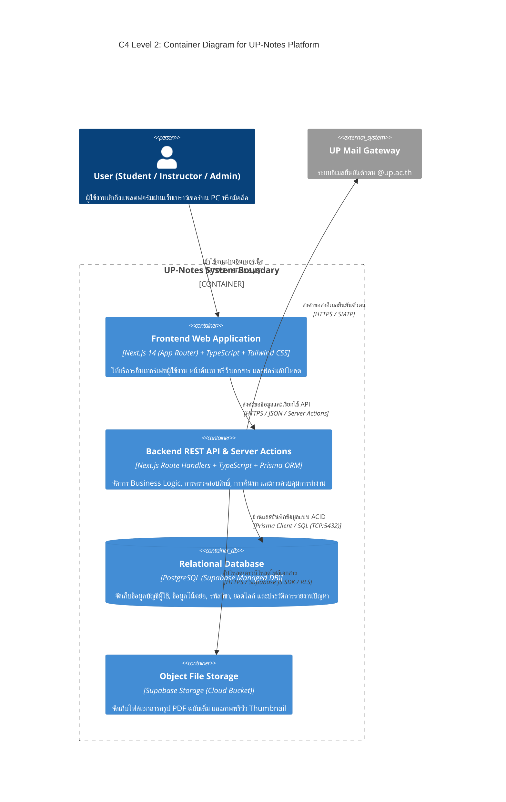

# 📦 C4 Model — Level 2: Container Diagram (UP-Notes)

แผนภาพ **C4 Level 2: Container Diagram** แสดงส่วนประกอบระดับคอนเทนเนอร์ (Containers) เทคโนโลยีที่เลือกใช้ และโปรโตคอลการสื่อสารภายในระบบ **UP-Notes**

---

## 1. C4 Container Diagram (Mermaid)

---

## 2. รายละเอียดเทคโนโลยีและความรับผิดชอบของแต่ละ Container

| Container Name | Technology Stack | บทบาทและความรับผิดชอบหลัก |
| :--- | :--- | :--- |
| **Frontend Web App** | Next.js 14 (App Router), TypeScript, Tailwind CSS, shadcn/ui | ให้บริการหน้าเว็บฝั่งผู้ใช้ (Client Interface), รองรับการแสดงผล Responsive ทั้ง PC และมือถือ, แสดงผลพรีวิว PDF และจัดการ UI State |
| **Backend REST API** | Next.js Route Handlers, TypeScript, Prisma ORM | ให้บริการ RESTful API, บังคับใช้ Business Rules, การตรวจสอบความถูกต้องของข้อมูล (Validation), และควบคุมการเข้าถึงสิทธิ์ (Authorization) |
| **Relational Database** | PostgreSQL (Supabase Managed) | จัดเก็บข้อมูลเชิงโครงสร้างที่มีความสัมพันธ์ (Relational Data) อย่างปลอดภัยตามมาตรฐาน ACID |
| **Object File Storage** | Supabase Storage (S3-Compatible Bucket) | จัดเก็บไฟล์สื่อไบนารีขนาดใหญ่ (PDF, PNG, JPG) พร้อมบังคับใช้ Row Level Security (RLS) เพื่อป้องกันการแอบเข้าถึงไฟล์ |
