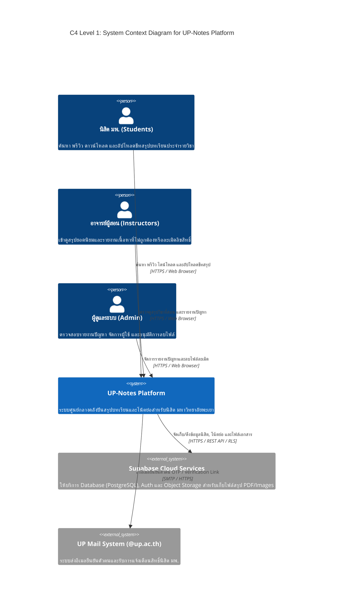

# 🗺️ C4 Model — Level 1: System Context Diagram (UP-Notes)

แผนภาพ **C4 Level 1: System Context Diagram** แสดงขอบเขตของระบบ **UP-Notes** การโต้ตอบกับผู้ใช้งานกลุ่มต่างๆ และการเชื่อมต่อกับระบบภายนอก (External Systems)

---

## 1. C4 System Context Diagram (Mermaid)

---

## 2. อธิบายองค์ประกอบและขอบเขตระบบ (System Elements Description)

### 👥 ผู้ใช้งานระบบ (Users / Actors)
1. **นิสิต มพ. (Students):** ผู้ใช้งานหลัก เข้ามาค้นหาชีทสรุปตามรหัสวิชา พรีวิวเอกสาร กดไลก์ ดาวน์โหลดไฟล์ PDF ออฟไลน์ และอัปโหลดชีทสรุปของตนเอง
2. **อาจารย์ผู้สอน (Instructors):** เข้ามาตรวจดูชีทสรุปวิชาที่ตนเองสอนเพื่อเช็กความถูกต้อง และรายงานไฟล์ข้อสอบเก่าที่ไม่อนุญาตให้เผยแพร่
3. **ผู้ดูแลระบบ (Admin):** ตรวจสอบรายงานปัญหา (Reports), อนุมัติการลบไฟล์ที่ละเมิดลิขสิทธิ์ และดูแลความสะอาดของระบบ

### ⚙️ ระบบหลัก (Main System)
* **UP-Notes Platform:** ระบบเว็บแอปพลิเคชันหลักที่ให้บริการจัดการโน้ตย่อ ค้นหารหัสวิชา พรีวิวเอกสาร และบริหารจัดการข้อมูลสรุปบทเรียน

### 🌐 ระบบภายนอก (External Systems)
1. **Supabase Cloud Services:** ให้บริการโครงสร้างพื้นฐานคลาวด์ ได้แก่ Database (PostgreSQL), Authentication Engine และ Object Storage สกัดกั้นการเข้าถึงไฟล์ที่ไม่ได้รับสิทธิ์ด้วย Row Level Security (RLS)
2. **UP Mail System (@up.ac.th):** ระบบอีเมลของมหาวิทยาลัยพะเยา ใช้ในการรับลิงก์ยืนยันตัวตนเพื่อการันตีว่าเป็นนิสิต มพ. จริง
